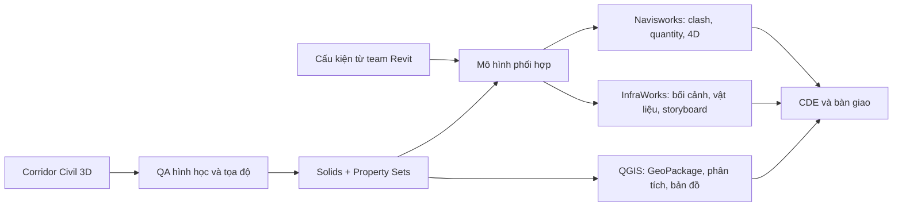

# BIM Tuyến 2027

Web app tự học BIM cho tuyến giao thông và hạ tầng kỹ thuật, bắt đầu từ thời điểm **đã có corridor Civil 3D và đã nhận đủ cấu kiện 3D từ team Revit**. Giáo trình không dạy dựng family Revit. Trọng tâm là hoàn thiện thông tin mô hình, phối hợp, kiểm tra, diễn họa, GIS, 4D/5D và bàn giao.

> Phạm vi phiên bản: Autodesk Civil 3D, Navisworks và InfraWorks 2027; QGIS theo tài liệu 3.40 đang được dẫn nguồn. Các bước được đánh dấu `documented` là hướng dẫn đã biên soạn, chưa thay thế kiểm tra trên bản sao mô hình thật của dự án.

## Nội dung

- 24 chương, 80 bài thực hành.
- Civil 3D sau corridor: QA hình học, bề mặt, vật liệu/code mapping, corridor solids, Property Sets, NWC/DWG/IFC 4.3 và khối lượng.
- Navisworks: federation, Search Sets, Clash Detective, issue workflow, Quantification và TimeLiner.
- InfraWorks: địa hình và ảnh nền, nhập corridor/cấu kiện, Component Mapping, vật liệu, camera, storyboard, ảnh và video.
- QGIS/GIS: CRS, GeoPackage, mapping thuộc tính, phân tích hành lang, bản đồ PDF và KML/KMZ.
- 4D/5D, CDE, kiểm soát thay đổi và capstone bàn giao.

Mỗi bài có mục tiêu, đầu vào, thao tác từng bước, kết quả cần thấy, checklist QA, lỗi thường gặp, bài tập, sản phẩm nộp, sơ đồ nguyên lý và nguồn tra cứu.

## Web app

Giao diện gồm ba vùng làm việc:

1. Danh mục và tìm kiếm không dấu trong toàn bộ 80 bài.
2. Nội dung thực hành, checklist và sơ đồ kỹ thuật.
3. Ghi chú cloud, ảnh minh chứng, nguồn Google Drive/nguồn chính thức và trợ lý tra cứu có dẫn nguồn.

Dữ liệu cá nhân được tách theo định danh đăng nhập. Ghi chú dùng kiểm soát phiên bản để phát hiện thay đổi từ máy khác. Ảnh lưu trong R2; ghi chú, checklist và lịch sử lưu trong D1. Người dùng có thể xuất/nhập bản sao JSON.

Trợ lý luôn có chế độ tra cứu trực tiếp trong giáo trình. Khi máy chủ có biến bí mật `GEMINI_API_KEY`, câu hỏi được gửi tới Gemini cùng các đoạn giáo trình liên quan; khóa không được đưa vào trình duyệt hoặc repository.

## Luồng dữ liệu chính



## Tài liệu và biểu mẫu

- [Tổng quan chương trình](docs/curriculum/00_TONG_QUAN_VA_QUY_TRINH.md)
- [Module 1 — Quy trình và nền tảng](docs/curriculum/MODULE_1_QUY_TRINH_VA_NEN_TANG.md)
- [Module 2 — Civil 3D solids và thuộc tính](docs/curriculum/MODULE_2_CIVIL3D_SOLIDS_PROPERTIES.md)
- [Module 3 — Navisworks](docs/curriculum/MODULE_3_NAVISWORKS_COORDINATION.md)
- [Module 4 — InfraWorks](docs/curriculum/MODULE_4_INFRAWORKS_VISUALIZATION.md)
- [Module 5 — QGIS/GIS](docs/curriculum/MODULE_5_QGIS_SPATIAL_ANALYSIS.md)
- [Module 6 — 4D/5D và bàn giao](docs/curriculum/MODULE_6_4D_5D_HANDOVER.md)
- [Bản đồ nguồn Google Drive](docs/references/GOOGLE_DRIVE_ASSETS.md)
- [Bộ biểu mẫu dự án](docs/templates)

Các liên kết Google Drive chỉ mở được khi tài khoản có quyền. Repository không chứa bản sao tài liệu Drive, dữ liệu dự án, token hoặc khóa API.

## Chạy cục bộ

Yêu cầu Node.js 22.13 trở lên.

```bash
npm install
npm run db:generate
npm run dev
```

Build và kiểm tra:

```bash
npm run lint
npx tsc --noEmit
npm run build
```

Các route ghi dữ liệu cần môi trường Sites cung cấp xác thực ChatGPT, D1 binding `DB` và R2 binding `BUCKET`. Cấu hình binding nằm trong [`.openai/hosting.json`](.openai/hosting.json). Migration đầu tiên nằm trong [`drizzle/`](drizzle).

## Biến môi trường phía máy chủ

| Tên | Bắt buộc | Mục đích |
|---|---:|---|
| `GEMINI_API_KEY` | Không | Bật câu trả lời Gemini. Không có khóa thì dùng tra cứu giáo trình. |
| `GEMINI_MODEL` | Không | Mặc định `gemini-2.5-flash`. |

Không commit tệp `.env`. Khi triển khai, đặt khóa bằng mục biến môi trường/secret của nền tảng.

## Giới hạn xác minh

- Build web và kiểm tra API không chứng minh thao tác Autodesk 2027 chạy đúng trên mô hình thật.
- Hướng dẫn tiêu chuẩn, dung sai và ánh xạ IFC phải được đối chiếu với nguồn ban hành hoặc Autodesk Help tại thời điểm áp dụng.
- Ảnh nền/DEM phục vụ bối cảnh không tự động trở thành dữ liệu thiết kế hoặc nghiệm thu cao độ.
