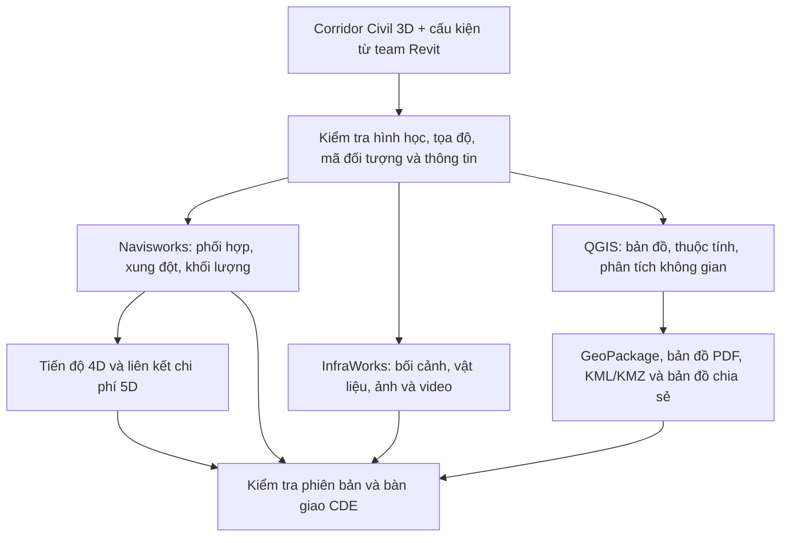

# BIM Tuyến 2027 — Giáo trình thực hành Civil 3D, Navisworks, InfraWorks và GIS

## 1. Mục tiêu và quy trình tổng thể

Bản giáo trình này xây dựng lộ trình thực hành toàn diện từ hình học tuyến đến mô hình thông tin, phối hợp liên bộ môn, diễn họa bối cảnh và phân tích không gian địa lý:
- Bổ sung **diễn họa InfraWorks** và **QGIS + bản đồ chia sẻ** thành hai trụ cột thực hành chính, có bài học, dữ liệu, đầu ra và tiêu chí kiểm tra riêng biệt.
- Xây dựng web học cá nhân chạy trên môi trường Windows / Web, giao diện **sổ tay kỹ thuật nền tối**, có hướng dẫn từng bước, hình minh họa, tra cứu nguồn, ghi chú, tiến độ và trợ lý **Gemini API trả lời có dẫn nguồn**.
- Điểm bắt đầu thực tế: **Corridor tuyến đã hoàn thành, chưa gán vật liệu; team đã có các cấu kiện Revit**. Tuyến mẫu xuyên suốt là đường ngoài đô thị / cao tốc khoảng 2 km, có nền–mặt đường, taluy, rãnh, cống ngang và tiếp giáp mố cầu.

### Sơ đồ luồng dữ liệu tổng thể

Ba nhánh phối hợp, diễn họa và GIS dùng chung **mã đối tượng, quy ước tọa độ và phiên bản nguồn**, nhưng có cách chuẩn bị dữ liệu riêng. Không bắt mọi đầu ra phải đi qua cùng một file solids.

Bài tốt nghiệp phải tạo được bốn nhóm sản phẩm: **mô hình phối hợp BIM, bộ ảnh/video diễn họa, bộ dữ liệu/bản đồ GIS và hồ sơ kiểm tra–bàn giao**.

---

## 2. Giáo trình đầy đủ: 24 chương, tối thiểu 80 bài

| Chương | Nội dung | Phần mềm | Sản phẩm thực hành |
|---|---|---|---|
| **1** | Tổng quan công việc sau corridor; mục tiêu BIM, yêu cầu thông tin, kế hoạch thực hiện và vai trò các thành viên | Quy trình | Sơ đồ quy trình và bảng trách nhiệm |
| **2** | Tổ chức thư mục, tên file, mã tuyến–hạng mục, Data Shortcuts, phiên bản và trạng thái phát hành | Quy trình | Bộ quy ước dự án |
| **3** | Kiểm tra corridor: baseline, region, target, frequency, code, surface, boundary, khoảng hở và chồng lấn | Civil 3D | Checklist chất lượng đầu vào |
| **4** | Tọa độ, đơn vị, cao độ và điểm kiểm tra chung giữa Civil 3D–Revit–InfraWorks–GIS | Civil 3D / Revit | Phiếu hệ tọa độ và bảng kiểm tra mốc |
| **5** | Vật liệu hiển thị, thông tin vật liệu và vật liệu tính khối lượng; Code Set Style và surface | Civil 3D | Bảng code–lớp kết cấu–vật liệu |
| **6** | Trích corridor solids/bodies; chia theo lớp, region và lý trình; quản lý liên kết cập nhật | Civil 3D | Bộ hình khối phục vụ BIM |
| **7** | Property Sets, mã đối tượng, lý trình, vật liệu, bộ môn, nguồn và phiên bản | Civil 3D | Từ điển thuộc tính và mẫu kiểm tra |
| **8** | Xuất NWC/DWG/IFC 4.3, ánh xạ đối tượng và kiểm tra dữ liệu sau xuất | Civil 3D | Gói trao đổi có kiểm tra |
| **9** | Nhận cấu kiện Revit, kiểm tra đầu vào, ghép mô hình Navisworks; NWF/NWC/NWD | Navisworks | Mô hình tổng hợp |
| **10** | Search Sets, Selection Sets, viewpoints, mặt cắt và màu phục vụ kiểm tra | Navisworks | Bộ công cụ kiểm tra mô hình |
| **11** | Ma trận clash, dung sai, giao cắt có chủ ý, phân nhóm lỗi, phản hồi và kiểm tra lại | Navisworks | Báo cáo xung đột và issue log |
| **12** | Khối lượng Civil 3D/solids/Navisworks; đơn vị, tính trùng và đối soát khác biệt | Navisworks | Bảng khối lượng có nguồn gốc |
| **13** | Quản lý thay đổi corridor và cấu kiện; cập nhật thuộc tính, sets, clash và khối lượng | Navisworks | Một vòng thay đổi thiết kế hoàn chỉnh |
| **14** | InfraWorks: chuẩn bị địa hình, ảnh nền và dữ liệu bối cảnh | InfraWorks | Mô hình bối cảnh đúng vị trí |
| **15** | InfraWorks: đưa tuyến và cấu kiện vào, kiểm tra hình học và vật liệu | InfraWorks | Mô hình diễn họa tuyến |
| **16** | InfraWorks: hoàn thiện cảnh quan, góc nhìn và phương án | InfraWorks | Bộ góc nhìn thuyết trình |
| **17** | InfraWorks: storyboard, camera, ảnh/video và cập nhật mô hình | InfraWorks | Bộ ảnh/video và quy trình cập nhật |
| **18** | GIS nền tảng cho kỹ sư tuyến: QGIS, CRS, vector/raster và dữ liệu nền | QGIS | Dự án QGIS đúng hệ tọa độ |
| **19** | Chuyển dữ liệu Civil/BIM sang GIS và liên kết thông tin | QGIS | GeoPackage tuyến và bảng thuộc tính |
| **20** | Phân tích tuyến bằng GIS, kiểm tra dữ liệu và tổ chức bản đồ | QGIS | Bản đồ phân tích hành lang tuyến |
| **21** | Bàn giao GIS, KML/KMZ và bản đồ chia sẻ | QGIS / Google Earth | Bộ GIS có thể mở lại và chia sẻ |
| **22** | 4D: WBS, phân đoạn thi công, liên kết đối tượng–công việc, TimeLiner | Navisworks | Mô phỏng thi công |
| **23** | 5D: liên kết khối lượng–mã công việc–đơn giá và kiểm soát thay đổi | Navisworks / Excel | Bảng chi phí truy ngược về khối lượng |
| **24** | CDE, phát hành, lưu trữ và bài tốt nghiệp tổng hợp | CDE / Đa phần mềm | Bộ bàn giao BIM–diễn họa–GIS |

Mỗi bài đều có cấu trúc chuẩn mực: **mục tiêu → dữ liệu đầu vào → lý do thực hiện → từng thao tác → hình/kết quả cần thấy → cách kiểm tra → lỗi thường gặp → bài tập → nguồn → ghi chú**.
